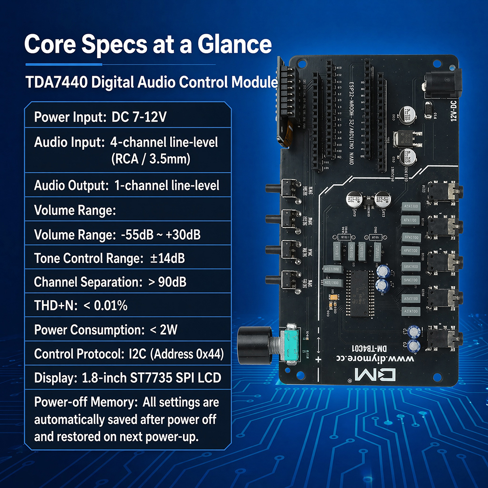
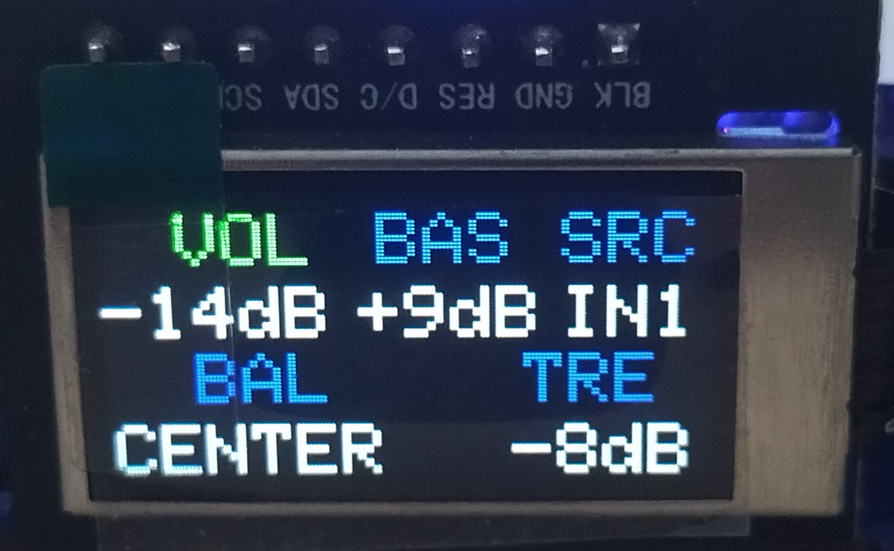
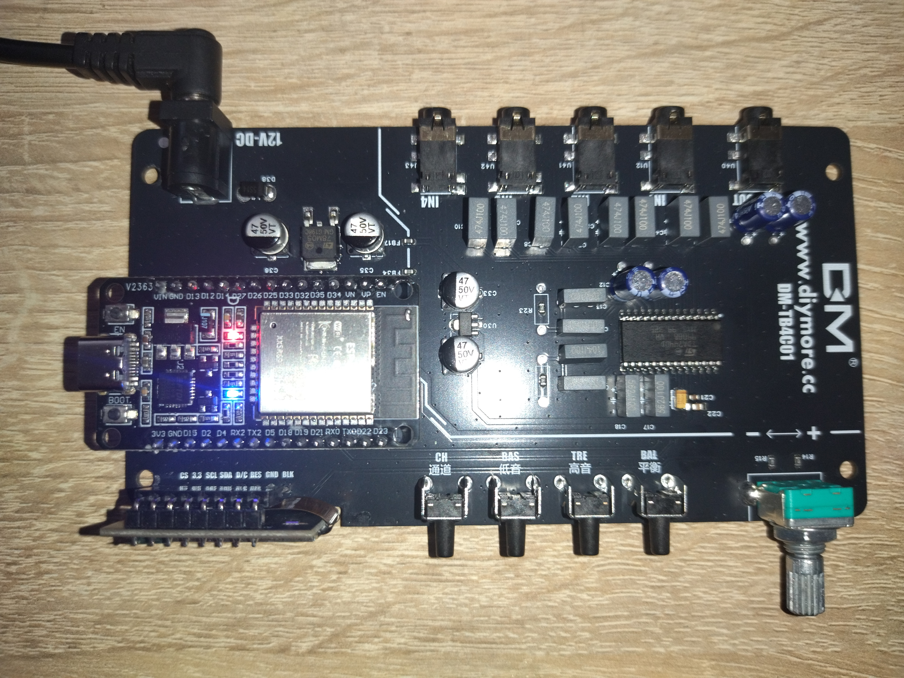

# DM-TB4C01 ESP32 Audio Controller (TDA7440 + ST7735)

A high-performance, robust, and pixel-perfect digital audio preamplifier firmware built for the **diymore DM-TB4C01** evaluation platform. It utilizes an **ESP32 NodeMCU** to interface with a **TDA7440** integrated audio processor chip and displays a crisp custom UI on an integrated **ST7735S 160x80 TFT Display**.

---

### 📢 Community & Project Note
This motherboard is widely available on **AliExpress** (sold under the diymore / Gaqqee brands). Unfortunately, many distributors fail to provide any working source code, documentation, or libraries to the buyers upon purchase. This repository was created out of frustration to fill that gap, offering the community a reliable, fully reverse-engineered, and open-source solution to finally bring this great hardware to life.

## ⚠️ CRITICAL BUYING & SAFETY WARNINGS (READ BEFORE SETUP)

### 1. Mandatory Controller Board Requirement
- **ESP32 Core Dependency:** This module is an evaluation motherboard and **WILL NOT FUNCTION** without a separate microcontroller board plugged into it. 
- **Exact Model Compatibility:** You **MUST** use a **standard 38-pin ESP32-WROOM-32** module. 
- **Incompatible Models:** Do **NOT** purchase or attempt to use variant chips like the ESP32-S3, ESP32-C3, or ESP32-WROOM-32D. They feature completely different pin pitches and configurations, making them physically and electrically incompatible with the board sockets.

### 2. Strict Flashing Sequence (Anti-Freeze Protocol)
- **Programming Mode:** When compiling and uploading code from your PC via Arduino IDE, **NEVER power the motherboard with the external 12V DC adapter**. Keep the 12V power supply completely unplugged. The ESP32 must run purely on the USB cable's 5V rail during the flashing process.
- **Why?** Connecting both the 12V DC input and the PC USB cable simultaneously triggers a ground loop feedback back-current. This overloads the USB communication bridge, forcing the computer's OS to safe-lock the COM port, which instantly freezes the Arduino IDE uploading pipeline.
- **Normal Operation:** Only plug in the 12V DC power jack **AFTER** the code has been successfully flashed onto the ESP32 and the USB cable has been completely disconnected from your computer.

---

## 🚀 Key Technical Features

- **Hardware-Interrupt Rotary Encoder:** Precise quadrature decoding running on hardware interrupts, guaranteeing zero dropped steps even during rapid dial turns.
- **Dynamic Dial Acceleration:** A smart mathematical filter detects rotation speed. Slow turns adjust volume by `1dB`, while rapid spins automatically switch to `3dB` steps for quick level changes.
- **Ghost-Pixel Prevention Layout:** Custom right-aligned, dynamically erased display bounding boxes ensure crisp value updates without visual rendering artifacts.
- **Smart EEPROM Flash Save (3s):** To preserve Flash write cycles, a non-volatile memory dump executes only after **3 seconds of total user inactivity**, keeping your volume, balance, tone, and input settings safe against power cuts.
- **Per-Channel Audio Profiles (`IN1`–`IN4`):** Independent non-volatile memory for Volume, Bass, and Treble per input channel.
- **Soft-Ramp Volume Transitions:** Smooth stepped volume fading to prevent audible clicks and pops.
- **Physiological Loudness (`LDNS`):** Dynamic low-volume contour compensation boosting Bass and Treble.
- **PWM Display Auto-Dimmer:** Automatically dims the TFT backlight after inactivity and wakes cleanly on interaction.

## 🕹️ User Interface & Operation Logic

This firmware introduces an intuitive, amplifier-style state machine using the 4 dedicated tactile keys and the clickable rotary encoder:

1. **Default Mode (Volume Control):** Upon boot, the active green parameter is always **VOL** (Volume). Turning the encoder directly attenuates the audio from `-50dB` (minimum) to `+30dB` (maximum).
2. **Direct Menu Selection:** Pressing any of the dedicated keys (`BAS`, `TRE`, `BAL`, `SRC`) instantly highlights that parameter in **green**, allowing the rotary encoder to modify its specific value.
3. **Auto-Timeout Return to Volume (5s):** If you adjust a sub-parameter (e.g., boosting Bass or switching input sources) and leave the controls idle for **5 seconds**, the selection cursor automatically snaps back to **VOL**. This keeps the dial ready for volume adjustments without extra clicks.
4. **Context-Aware Encoder Push Button (`PUSH`):** The built-in rotary push button features a dual-mode operation depending on the current menu state:
   - **From Sub-Menus (Quick Exit):** When adjusting a sub-parameter (like `TRE` or `BAL`), pressing `PUSH` immediately exits the sub-menu and returns focus to **VOL** without altering the audio output.
   - **From Main Menu (Mute Toggle):** When the cursor is already on **VOL**, pressing `PUSH` toggles the **MUTE** state. A bright red **MUTE** warning overrides the screen layout. Turning the dial or pressing any menu key instantly disengages mute.

---

## 🛠️ Software & Library Versions

The firmware is fully verified and compiled under the following software stack:
- **Arduino IDE** v2.3.10
- **Adafruit_GFX Library** v1.13.0
- **Adafruit_ST7735 and ST7789 Library** v1.12.0

## 🔌 Hardware Pinout (DM-TB4C01 Native Layout)

| Peripheral | Function | ESP32 GPIO Pin |
| :--- | :--- | :--- |
| **ST7735 TFT** | Chip Select (CS) | **GPIO 15** |
| **ST7735 TFT** | Data / Command (DC) | **GPIO 2** |
| **ST7735 TFT** | Reset (RST) | **GPIO 4** |
| **ST7735 TFT** | Serial Clock (SCLK) | **GPIO 18** |
| **ST7735 TFT** | Master Out (MOSI/SDA)| **GPIO 23** |
| **ST7735 TFT** | Backlight Control (BLK)| **GPIO 32** |
| **Tactile Key** | Channel Source (CH) | **GPIO 33** |
| **Tactile Key** | Bass Level (BAS) | **GPIO 27** |
| **Tactile Key** | Treble Level (TRE) | **GPIO 14** |
| **Tactile Key** | Balance Adjustment (BAL)| **GPIO 13** |
| **Rotary Click**| Push / Mute Button (PUSH)| **GPIO 12** |
| **Encoder Dial**| Quadrature Phase A | **GPIO 26** |
| **Encoder Dial**| Quadrature Phase B | **GPIO 25** |
| **TDA7440 Chip**| I2C Data Line (SDA) | **GPIO 21** |
| **TDA7440 Chip**| I2C Clock Line (SCL) | **GPIO 22** |

## 📄 License

This project is open-source and available under the MIT License. Feel free to fork, expand, or use it in your custom desktop amplifiers!

---
Developed with ❤️ by **Gabor Nemes** in proud collaboration with **Gemini AI**.
